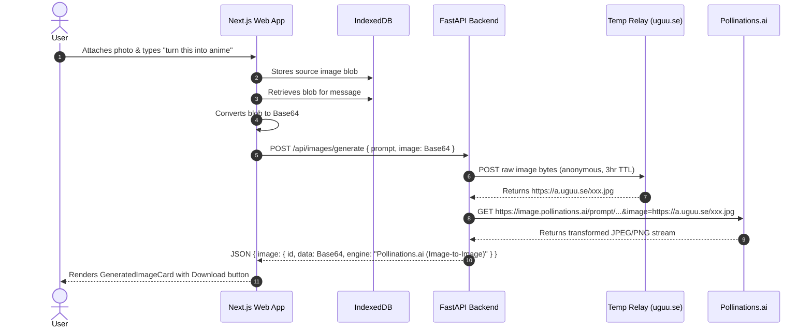

# Image-to-Image Architecture

This document outlines the architecture, data flow, and components of the Image-to-Image / Photo Editing feature.

```
┌────────────────────────────────────────────────────────────────────────┐
│                          Next.js Frontend                              │
│                                                                        │
│  1. User attaches photo (stored in IndexedDB)                          │
│  2. User enters edit prompt: "turn this into an anime cyberpunk scene" │
│  3. helpers.ts -> detectImagePrompt() detects editing pattern          │
│  4. use-chat.ts:                                                       │
│     - Appends user message with photo thumbnail                        │
│     - Loads blob from IndexedDB via loadImage(img.id)                  │
│     - Converts blob to Base64 (blobToBase64)                           │
│     - Calls POST /api/images/generate with { prompt, image, ... }      │
│     - Renders <GeneratedImageCard /> in assistant bubble               │
│     - Supports regenerate() with new random seed                       │
└──────────────────────────────┬─────────────────────────────────────────┘
                               │
                               │ HTTP POST /api/images/generate
                               ▼
┌────────────────────────────────────────────────────────────────────────┐
│                          FastAPI Backend                               │
│                                                                        │
│  app/routes/images.py                                                  │
│  - ImageGenRequest receives { prompt, image: "data:image/jpeg;base64"} │
│  - Routes to generate_image_to_image()                                 │
│                                                                        │
│  app/services/image_gen.py                                             │
│  - upload_temp_image(image_data):                                      │
│    ├── Decodes Base64 to raw bytes                                     │
│    ├── Uploads to temporary relay (uguu.se / freeimage.host)           │
│    └── Returns temporary public URL (expires automatically in 3 hours) │
│                                                                        │
│  - generate_with_pollinations(prompt, image_url=source_url):           │
│    ├── Calls Pollinations.ai img2img transformation API                │
│    └── Returns generated image bytes + media type                      │
└────────────────────────────────────────────────────────────────────────┘
```

---

## 1. Sequence Flow



---

## 2. Why Cloud Relaying is Necessary for Local Laptops

Cloud AI inference engines (such as Pollinations or Replicate) require an accessible URL to download the source image for processing. Because the user's laptop runs locally on `localhost` (behind NAT / home firewall), the cloud engine cannot fetch `http://localhost:3000/...` or `http://127.0.0.1:8000/...`.

To solve this without paid cloud hosting or requiring ngrok tunnels:
1. The backend offloads the source image payload to **uguu.se** (a high-speed, anonymous, temporary file hosting service with a 3-hour automatic deletion policy).
2. If `uguu.se` is ever unavailable, the system automatically falls back to **freeimage.host**.
3. Once Pollinations finishes fetching the image and generating the stylized variant, the temporary link expires naturally. No private user data persists.

---

## 3. Preservation of Source Image in Chat History

Unlike single-turn converters that replace the user's prompt, the copilot retains the source image thumbnail in the user bubble and the transformed artwork in the assistant bubble:
- **Conversation Context**: History accurately reflects what the user provided and what the assistant generated.
- **Regenerate Support**: When the user clicks the assistant message's Regenerate button, `use-chat.ts` extracts the original source photo from the preceding user message in `conversations` history and requests a fresh transformation with a new seed.
