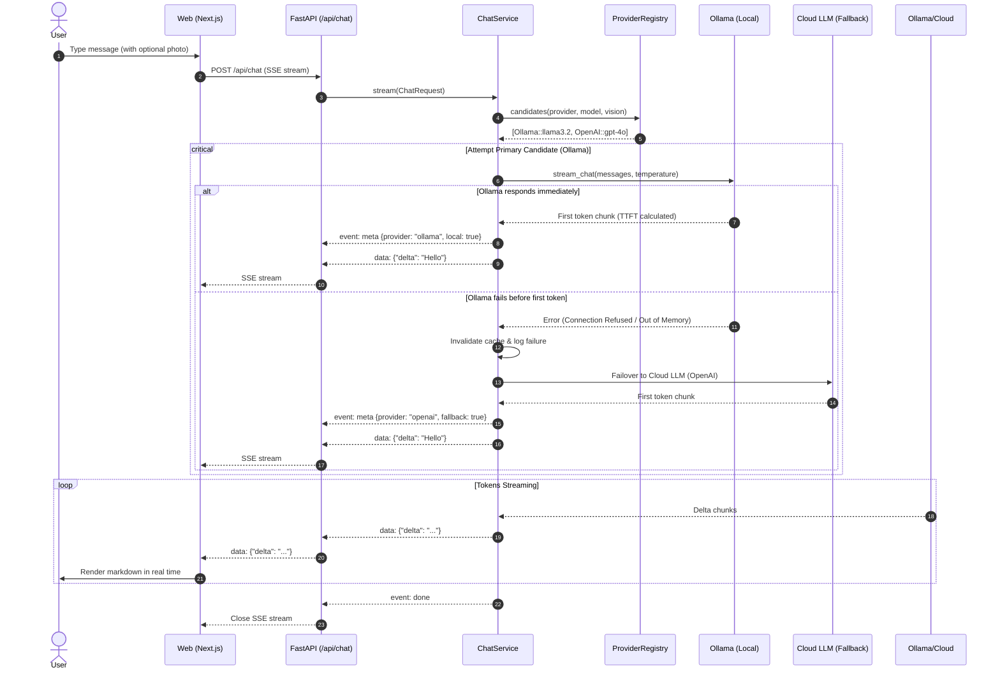
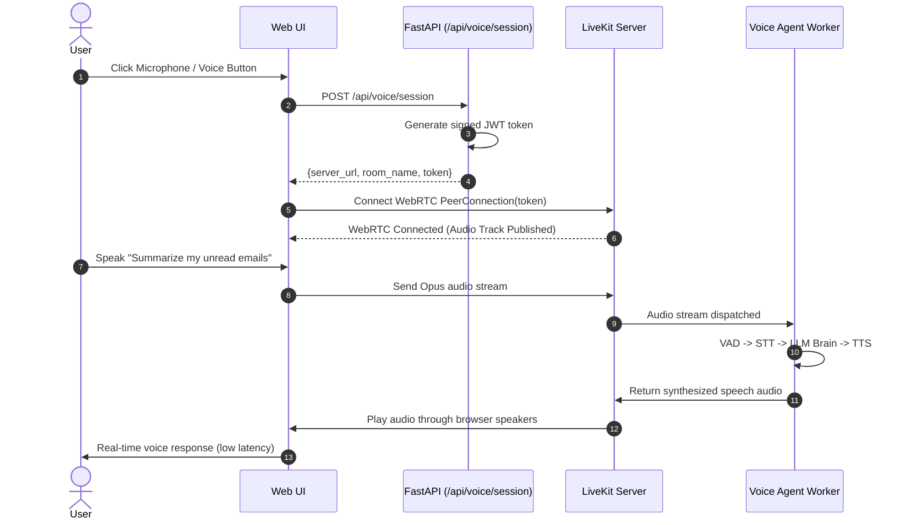
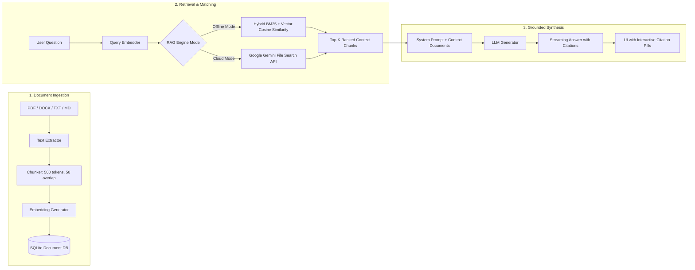

# NexusMind — Technical Architecture & System Documentation

> **A local-first, multi-modal, cloud-resilient AI platform featuring real-time SSE streaming, WebRTC voice communication, text-to-image and image-to-image generation, dual-engine RAG, and live observable tracing.**

---

## 1. Project Overview and Objectives

### 1.1 Executive Summary
**NexusMind** is an enterprise-grade, privacy-centric AI platform designed to bridge local edge intelligence with cloud AI models. It delivers a conversational interface that unifies **Text Chat**, **Vision Understanding**, **Real-Time WebRTC Voice Mode**, **Generative Image Synthesis & Editing**, and **Document Retrieval-Augmented Generation (RAG)** into a single cohesive application.

### 1.2 Core Objectives
* **Local-First, Cloud-Fallback Philosophy**: Default to local, zero-cost, private models running on device via [Ollama](http://localhost:11434) (e.g., `llama3.2`, `gemma3:1b`). Seamlessly and automatically failover to cloud providers ([OpenAI](https://openai.com), [Anthropic](https://anthropic.com), [Google Gemini](https://ai.google.dev), [xAI Grok](https://x.ai), and [Meta](https://meta.com)) only when local resources are missing, offline, or fail before the first token is produced.
* **Unified Multi-Modal Experience**: Allow users to chat, speak with low-latency bidirectional voice, upload photos for visual reasoning, attach documents for citations, and create or transform images directly in the flow of conversation without context switching.
* **Zero-Configuration Image Generation**: Eliminate complex manual menu navigation. Enable natural language triggering (e.g. *"Generate an image of a cybernetic tiger"* or *"Edit this photo to look like a watercolor painting"*) with automatic fallback between free tier engines ([Pollinations.ai](https://pollinations.ai)) and GPU-accelerated cloud APIs ([Hugging Face](https://huggingface.co)).
* **Enterprise Observability & Traceability**: Maintain complete transparency into internal operations through contextual `X-Request-ID` correlation, structured terminal logging, rotating disk audit logs, an in-memory ring buffer, and a live web dashboard (`/api/logs/view`).
* **Modular Skill Extensibility**: Encapsulate standalone features (such as voice, library, and image generation) as independent, portable `.claude/skills/` modules that can be packaged, distributed, and maintained independently.

---

## 2. Complete Application Flow

The diagram below maps the complete end-to-end journey of a user interaction across the system:

```mermaid
flowchart TD
    User([User in Web App]) --> Composer[Input Composer / Attachment Tray]
    
    %% Input Routing
    Composer -->|Text / Photo| ChatHook[useChat Hook]
    Composer -->|Generate Image Command| ImgHook[useImageGen / Image Router]
    Composer -->|Voice Toggle| VoiceHook[useVoice / LiveKit Client]
    Composer -->|Upload Doc| LibraryUI[Library Document Manager]

    %% Chat & Vision Flow
    ChatHook -->|POST /api/chat (SSE)| ChatRoute[FastAPI Chat Route]
    ChatRoute --> Middle[RequestLoggingMiddleware\nX-Request-ID Injected]
    Middle --> IntentCheck{Check Intent & Payload}
    
    IntentCheck -->|RAG Enabled| RAGService[Library Service / RAG Engine]
    IntentCheck -->|Standard Chat / Vision| ChatService[Chat Service]
    
    RAGService --> VectorStore[(SQLite / Gemini File Search)]
    VectorStore --> GroundedPrompt[Context-Augmented Prompt]
    GroundedPrompt --> ChatService
    
    ChatService --> Registry[Provider Registry]
    Registry --> Probe{Try Candidates in Priority Order}
    
    Probe -->|1. Local| Ollama[Ollama Server :11434]
    Probe -->|2. Cloud Fallback| CloudLLM[OpenAI / Anthropic / Gemini / Grok]
    
    Ollama -->|Stream Tokens| StreamPipe[SSE Generator]
    CloudLLM -->|Stream Tokens| StreamPipe
    StreamPipe -->|event: delta / meta| WebUI[Next.js React UI Streaming]

    %% Image Flow
    ImgHook -->|POST /api/images/generate| ImgRoute[FastAPI Images Route]
    ImgRoute --> ImgService[Image Gen Service]
    ImgService --> IsImg2Img{Is Image-to-Image?}
    
    IsImg2Img -->|Yes| Relay[Upload source to temp public host\nuguu.se / freeimage.host]
    IsImg2Img -->|No| PromptEngine[Prompt & Engine Selection]
    Relay --> PromptEngine
    
    PromptEngine --> EngineProbe{Try Engines}
    EngineProbe -->|Primary: Free| Pollinations[Pollinations.ai API]
    EngineProbe -->|Fallback: Token| HuggingFace[Hugging Face FLUX / SD API]
    
    Pollinations --> ImgResult[Base64 Encoded Image Data]
    HuggingFace --> ImgResult
    ImgResult --> ImgCard[GeneratedImageCard Component]

    %% Voice Flow
    VoiceHook -->|POST /api/voice/session| VoiceRoute[FastAPI Voice Route]
    VoiceRoute --> LKService[LiveKit WebRTC Cloud / Server]
    LKService --> WebRTCChannel[Bidirectional WebRTC Audio]
    WebRTCChannel <--> VoiceAgent[LiveKit Voice Agent Worker]

    %% Logging Trace
    Middle -.-> LogBuffer[(Circular In-Memory Buffer)]
    Middle -.-> LogFile[(Rotating File: copilot.log)]
    LogBuffer -.-> LogViewer[Live HTML Log Viewer /api/logs/view]
```

---

## 3. High-Level System Architecture

The project adheres to a clean, decoupled two-tier architecture running on separate ports:

```
+----------------------------------------------------------------------------------+
|                            FRONTEND (Port 3000)                                  |
|   Next.js 16 (App Router) * React 19 * TypeScript 7 * Tailwind CSS * Lucide UI   |
+----------------------------------------------------------------------------------+
                                        |  HTTP / SSE / WebSockets / WebRTC
                                        v
+----------------------------------------------------------------------------------+
|                            BACKEND (Port 8000)                                   |
|       FastAPI * Python 3.13 * Pydantic v2 * Uvicorn (ASGI) * AsyncIO             |
+----------------------------------------------------------------------------------+
         |                        |                       |                |
         v                        v                       v                v
+------------------+    +-------------------+    +------------------+  +-----------+
| Local AI Engine  |    | Cloud Providers   |    | Image Engines    |  | WebRTC    |
| Ollama (:11434)  |    | OpenAI, Anthropic |    | Pollinations.ai  |  | LiveKit   |
| llama3.2, gemma3 |    | Gemini, Grok, Meta|    | Hugging Face Hub |  | Cloud     |
+------------------+    +-------------------+    +------------------+  +-----------+
```

### 3.1 Network Topology & Communication Ports
| Component | Technology | Default Port | Primary Protocol | Responsibility |
| :--- | :--- | :--- | :--- | :--- |
| **Frontend Web** | Next.js 16 / React 19 | `3000` | HTTP / HTTPS | User Interface, markdown streaming, WebRTC audio, client caching |
| **Backend API** | FastAPI / Python 3.13 | `8000` | HTTP / SSE | Provider routing, fallback orchestration, RAG, image dispatch, logging |
| **Local AI Service** | Ollama Daemon | `11434` | HTTP / REST | Local model weights, quantized inference (GGUF), offline embeddings |
| **Voice Server** | LiveKit Cloud / Server | `443` / `7880` | WebRTC / WSS | Real-time audio transport, VAD (Voice Activity Detection), STT/TTS |
| **Public Image Relay**| Uguu / FreeImage | Public HTTPS | HTTPS POST | Temporary bridging for cloud image-to-image endpoints |

---

## 4. Web, API, Agent, and Skills Architecture

### 4.1 Frontend Architecture (`frontend/` / `copilot-app/web/`)
The frontend is built using Next.js 16 with React 19 and Tailwind CSS:
* **`app/page.tsx` & `components/chat/chat-app.tsx`**: Central application coordinator holding session state, message threads, model selections, active attachments, and dialogs.
* **`components/chat/composer.tsx`**: Multi-modal input box supporting dynamic auto-expanding textarea, slash commands, direct file/photo drag-and-drop, photo paste from clipboard, and voice mode button.
* **`components/chat/message.tsx` & `markdown.tsx`**: Custom streaming renderer with syntax-highlighted code blocks, copy buttons, inline image cards, citation badges, and time-to-first-token indicators.
* **`components/chat/model-picker.tsx`**: Displays active models, categorizing them into *Local Models* (green indicator) and *Cloud Providers* (OpenAI, Anthropic, Gemini, Grok, Meta). Shows capability badges (`Sees images`, `Local`, etc.).
* **`components/chat/image-gen-dialog.tsx` & `generated-image-card.tsx`**: Image modal and message card rendering generated images with download, zoom, prompt replication, and image-to-image re-prompting.
* **`components/library/`**: Complete document administration UI for collections, file uploads, document indexing statuses, and retrieval testing.
* **`components/voice/`**: WebRTC voice room overlay with real-time waveform bars, mute/unmute, and disconnection controls.
* **`lib/api.ts`**: Unified typed API client with SSE generator parsing (`readChatStream`), model fetching, image generation requests, and browser console logging.

### 4.2 Backend Architecture (`backend/` / `copilot-app/api/`)
The backend is structured around a service-layer pattern with dependency injection:
* **`app/main.py`**: ASGI application factory, CORS policies, lifespan manager, middleware mounting, and sub-router registrations.
* **`app/core/logging_middleware.py`**: Pure ASGI middleware extracting or issuing `X-Request-ID`, timing requests, and recording access logs.
* **`app/core/logging.py`**: Structured log formatting, circular in-memory buffer (`_log_buffer` max 1,000 entries), and rotating file logs (`logs/copilot.log`).
* **`app/providers/`**: Pluggable provider system:
  * `base.py`: Defines abstract `Provider` interface with `list_models()`, `stream_chat()`, and `vision_check()`.
  * `ollama.py`: Local Ollama integration via official Python SDK.
  * `openai.py`, `anthropic.py`, `gemini.py`, `grok.py`, `meta.py`: Cloud provider clients.
  * `registry.py`: Model discovery, background health caching (with 30-second TTL), and prioritization engine.
* **`app/routes/`**:
  * `chat.py`: Handles `POST /api/chat` with SSE response streaming.
  * `images.py`: Handles `POST /api/images/generate` and `GET /api/images/config`.
  * `library/routes.py`: Handles collections, document ingestion, and search.
  * `voice/routes.py`: Issues LiveKit room connection tokens and verifies voice credentials.
  * `logs.py`: Exposes `GET /api/logs` (JSON/text) and serves `/api/logs/view` (live HTML dashboard).

### 4.3 Agent & Skills Architecture (`.claude/skills/`)
The project utilizes a modular **Skills System** where complex capabilities are packaged as self-contained bundles:
```
.claude/skills/
├── add-image-gen/              # Text-to-Image skill bundle
│   ├── SKILL.md                # Skill instructions, workflows, triggers
│   ├── assets/                 # Copy-paste source code (api/ and web/)
│   ├── references/             # Engine docs, prompts, and API contracts
│   └── scripts/                # Verification and doctor scripts
├── image-to-image/             # Image-to-Image editing skill bundle
│   ├── SKILL.md
│   ├── assets/
│   ├── references/
│   └── scripts/
├── add-files-library/          # Document RAG & indexing skill bundle
├── livekit-voice-mode/         # WebRTC voice assistant skill bundle
└── add-photos/                 # Multi-modal vision inspection skill bundle
```
Each skill contains:
1. **Frontmatter & Metadata**: Defines prerequisites, intents, and capabilities.
2. **Standard Reference Documents**: Architectural guides, curl tests, and contract documentation.
3. **Automated Verification Scripts**: Self-test scripts (`doctor_voice.py`, `test_image_gen.py`) verifying credentials and network connectivity before enabling features in the UI.

---

## 5. Detailed Workflows: Chat, Voice, Image, and Files

### 5.1 Chat & Vision Workflow


### 5.2 Real-Time Voice Workflow (LiveKit WebRTC)


### 5.3 Image Generation & Image-to-Image Workflow
1. **Natural Language Detection**: When the user enters a prompt containing image intents (e.g., *"Generate a logo for..."*, *"Draw a picture of..."*, or selects *Generate Image* in the composer), the system intercepts the request.
2. **Source Image Handling (Image-to-Image)**:
   * If the user attached an image, it is converted to base64.
   * Because remote inference APIs cannot access `localhost` or base64 data URLs directly, the backend relays the image to a temporary public host (`uguu.se` or `freeimage.host`) with anonymous short-lived expiry.
3. **Engine Cascade**:
   * **Engine 1: Pollinations.ai**: Zero-key, free-tier generation using FLUX.1.
   * **Engine 2: Hugging Face Hub**: Authenticated GPU generation using Hugging Face Inference API (`black-forest-labs/FLUX.1-schnell` or Stable Diffusion).
4. **Rendering**: The response returns a base64 payload rendered in an interactive card allowing full-screen preview, copy-to-clipboard, or immediate re-prompting.

---

## 6. RAG / File Search Flow

The system includes a dual-engine Retrieval-Augmented Generation (RAG) architecture:



### 6.1 RAG Components
* **Offline Engine (`offline.py`)**: Completely self-hosted. Uses SQLite for metadata and inverted text indexing combined with local vector embeddings. Does not require external services or remote data transmission.
* **Gemini File Search Engine (`gemini.py`)**: Utilizes Google's Gemini File Search tool for larger corpora, offloading semantic chunking and indexing to Google's specialized infrastructure.
* **Citation Pipeline (`citations.py`)**: Intercepts LLM outputs containing citation markers (e.g., `[^1]`), resolving them back to exact file names, page numbers, and chunk snippets shown as clickable hover cards in the chat.

---

## 7. Important AI Concepts Used

1. **Local vs. Cloud LLM Inference**:
   * Local inference operates on quantized GGUF weights executed through CPU/GPU (Ollama), prioritizing privacy, unlimited zero-cost generation, and offline functionality.
   * Cloud inference provides access to massive foundation models with superior reasoning capabilities, serving as an automatic fallback when local execution is unavailable.
2. **Multi-Modal Vision Language Models (VLM)**:
   * Vision-enabled models (e.g., `llama3.2-vision`, `gpt-4o`) accept interleaved text and image tokens via standard image preprocessing (downsampling, normalization, and patch projection).
3. **Retrieval-Augmented Generation (RAG)**:
   * Combines dense vector retrieval (semantic proximity) and sparse lexical retrieval (BM25 keyword matching) to ground LLM completions in proprietary documents while preventing hallucinations.
4. **Diffusion & Flow Matching Generative Models**:
   * Utilizes state-of-the-art text-to-image models (FLUX.1 Schnell, Stable Diffusion XL) that transform gaussian noise into high-resolution images guided by cross-attention text embeddings.
5. **Real-Time Voice Activity Detection (VAD) & WebRTC**:
   * Low-latency bidirectional audio streaming using WebRTC with Silero VAD to detect pauses in user speech, immediately triggering STT and LLM generation without requiring push-to-talk button presses.
6. **Time-To-First-Token (TTFT) Optimization**:
   * Evaluates prompt evaluation speed and streaming responsiveness, logging TTFT metrics on every turn to detect latency degradation across providers.

---

## 8. Technologies and Tools Used

### Frontend Stack
* **Framework**: [Next.js 16](https://nextjs.org/) (React 19, App Router, TypeScript 7)
* **Styling & Components**: [Tailwind CSS 4](https://tailwindcss.com/), Radix UI primitives, Lucide Icons
* **Markdown & Syntax Highlighting**: `react-markdown`, `remark-gfm`
* **Real-Time Transport**: Native Server-Sent Events (SSE), `@livekit/components-react`, `livekit-client`

### Backend Stack
* **Web Framework**: [FastAPI](https://fastapi.tiangolo.com/) (Python 3.13, ASGI, Uvicorn)
* **Package Management**: [uv](https://github.com/astral-sh/uv) (Extremely fast Python package installer and resolver)
* **Data Validation & Settings**: [Pydantic v2](https://docs.pydantic.dev/), `pydantic-settings`
* **Linter & Formatter**: [Ruff](https://astral.sh/ruff)
* **AI Provider SDKs**: `ollama`, `openai`, `anthropic`, `google-genai`, `huggingface-hub`, `livekit-api`
* **Document Parsers**: `pypdf`, `python-docx`
* **Image Processing**: `Pillow` (PIL)

---

## 9. Key Contributions and Implementation Decisions

### 9.1 In-Chat Natural Language Image Generation
* **Decision**: Instead of forcing the user to leave the conversation or click separate menu items to generate images, natural language intent is supported directly inside the chat flow.
* **Mechanism**: Users can type prompts like *"Generate an image of a neon city"* or click the image icon in the input composer. The chat route seamlessly delegates to the image service and returns rendered media items.

### 9.2 Public Image Relay for Cloud Image-to-Image
* **Problem**: Cloud image-to-image endpoints (such as Pollinations and Hugging Face) require accessible public HTTP URLs for source images, but user images exist only as local base64 data URLs on `localhost`.
* **Solution**: Implemented an automated relay pipeline in `app/services/image_gen.py` that uploads the base64 source image to temporary public hosting (`uguu.se` with 3-hour expiry, falling back to `freeimage.host`), retrieves the public URL, and passes it to the generation engine.

### 9.3 Unified Observability & Logging Architecture
* **Decision**: Full transparency was implemented across every component:
  * **ASGI Request Logging**: Injects unique `X-Request-ID` headers to trace every request.
  * **In-Memory Ring Buffer**: Stores the most recent 1,000 log events with zero disk overhead.
  * **Live HTML Log Viewer**: Interactive dashboard at `http://localhost:8000/api/logs/view` featuring real-time auto-refresh, level filtering, keyword search, and one-click clipboard export.
  * **Rotating File Logs**: Writes to `logs/copilot.log` (10MB limit with 5 backups).

### 9.4 Robust Fallback & Failure Isolation
* **Decision**: Provider fallbacks only trigger *before* the first token is sent. Once tokens begin streaming to the client, the model will not switch mid-answer (which would cause disjointed output); instead, downstream errors are handled gracefully.

---

## 10. Live / Demo-Ready Running Guide

Follow these steps to launch and demo the complete project locally:

### 10.1 Prerequisites
1. **Node.js**: Ensure Node.js 20+ is installed (`node -v`).
2. **Python & uv**: Ensure Python 3.13 and `uv` are installed (`uv --version`).
3. **Ollama**: Download and run [Ollama](https://ollama.ai). Pull at least one model:
   ```bash
   ollama pull llama3.2
   ```

### 10.2 Starting the Backend API
```bash
cd copilot-app/api
uv sync
uv run fastapi dev
```
* **API Documentation**: [http://localhost:8000/docs](http://localhost:8000/docs)
* **Live Log Dashboard**: [http://localhost:8000/api/logs/view](http://localhost:8000/api/logs/view)
* **Health Check**: [http://localhost:8000/api/health](http://localhost:8000/api/health)

### 10.3 Starting the LiveKit Voice Agent Worker
```bash
cd copilot-app/agent
uv sync
uv run python voice_agent.py dev
```
* Runs the LiveKit WebRTC Voice Agent worker in local development mode, connecting to the configured LiveKit room and routing audio through the backend API.

### 10.4 Starting the Frontend Web App
```bash
cd copilot-app/web
npm install
npm run dev
```
* **Web Application**: [http://localhost:3000](http://localhost:3000)

### 10.5 Running Quality Gates & Tests
```bash
# Backend Quality Checks
cd copilot-app/api
uv run pytest tests/test_logging.py tests/test_chat.py tests/test_image_gen.py tests/test_models.py
uv run ruff check .
uv run ruff format --check .

# Frontend TypeScript Verification
cd ../web
cmd.exe /c "npm run typecheck"
```

---

## 11. Challenges and Key Learnings

### 11.1 Image Generation Rate Limits & Cloudflare Blocks
* **Challenge**: The free Pollinations endpoint occasionally encountered Cloudflare anti-bot verification or intermittent rate limits when queried rapidly.
* **Resolution**: Implemented automatic fallback to Hugging Face Hub using the `black-forest-labs/FLUX.1-schnell` model whenever Pollinations returns non-200 responses or times out.

### 11.2 Handling Local vs. Cloud URLs in Image-to-Image
* **Challenge**: Users uploading personal photos expect immediate image-to-image transformations, but cloud diffusion APIs cannot read `localhost` URLs or large base64 strings in query parameters.
* **Resolution**: Built an anonymous multi-host public relay bridge that handles uploads asynchronously, caching the temporary public image link before dispatching generation requests.

### 11.3 SSE Streaming Disconnects & TTFT Tracking
* **Challenge**: If a user cancels generation or closes the browser tab mid-stream, standard synchronous loops could continue consuming upstream inference tokens in the background.
* **Resolution**: Added `request.is_disconnected()` polling inside the SSE event generator in `routes/chat.py`, cleanly closing upstream generators and logging client cancellations immediately.

### 11.4 Python 3.13 Syntax & Tooling Strictness
* **Challenge**: Python f-strings containing backslashes in nested brackets raised syntax errors under Python 3.13, and Ruff enforced strict line-length rules on embedded HTML templates.
* **Resolution**: Cleanly extracted string operations into helper functions, utilized `itertools.count` instead of global counters to maintain thread safety, and added targeted per-file ignores for HTML dashboard routes.

---

## 12. How the System Can Be Scaled

To transition this architecture from a single-machine local setup to high-concurrency production:

1. **Distributed Task Queue for Heavy Generations**:
   * Offload image synthesis and document embedding jobs to background workers using **Celery** or **ARQ** backed by **Redis**, returning job IDs and polling via WebSockets.
2. **Centralized Vector Database**:
   * Transition from local SQLite vector storage to managed vector databases such as **Qdrant**, **pgvector**, or **Pinecone** for multi-tenant collection indexing.
3. **Stateless API & Distributed Caching**:
   * Deploy the FastAPI backend inside containerized environments (Kubernetes / Docker) behind an **NGINX / Cloudflare Load Balancer**.
   * Replace in-memory log and model caches with a shared Redis cluster.
4. **Media CDN & Object Storage**:
   * Store generated images and document uploads in **Amazon S3** or **Cloudflare R2** with presigned upload URLs rather than local disk storage.

---

## 13. Future Features and Roadmap

* [ ] **Local Offline Image Generation**: Integrate a lightweight local Stable Diffusion / ONNX runtime or ComfyUI backend for 100% offline image creation without external relays.
* [ ] **Multi-Agent Orchestration**: Implement multi-agent workflows where specialized subagents (e.g., Code Reviewer, Researcher, Designer) collaborate on complex user prompts.
* [ ] **On-Device Whisper STT & Piper TTS**: Run voice interactions completely offline without requiring LiveKit cloud credentials.
* [ ] **Interactive Canvas / Artifact Editor**: Live code editor sidecar allowing users to run, render, and iterate on HTML/React code snippets generated during conversations.
* [ ] **Team Workspaces & Role-Based Access Control**: Multi-user authentication, shared collection libraries, and usage quota management.
